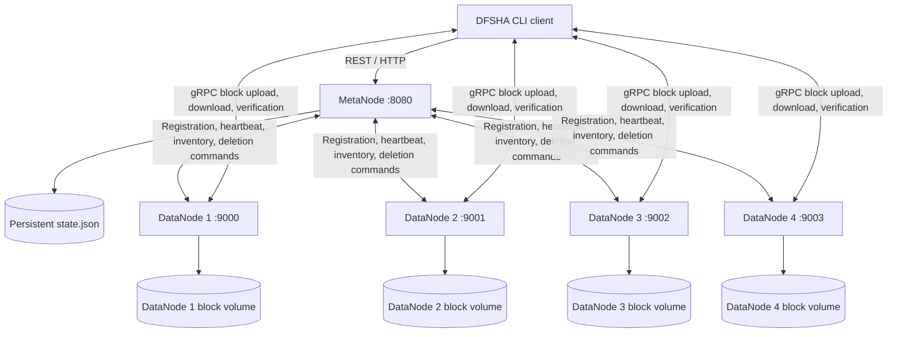

# DFSHA: Distributed File System

## Team Members

- **Juan Jose Gomez Ramirez**
- **Samuel Herrera Hoyos**
- **Sebastian Villegas Calle**

## Project Description

DFSHA is a distributed file-storage project written in Go. A **MetaNode** manages users and file-system metadata, while multiple **DataNodes** store file blocks on their own persistent disks. The repository includes a command-line client, a REST API, gRPC block operations, block replication, persisted MetaNode snapshots, and DataNode inventory reconciliation.

This README describes the architecture that is implemented in this repository and provides a Docker Compose quick start for Windows, Linux, and macOS.

> **Status and scope:** the default Docker Compose deployment runs one MetaNode and four DataNodes (four and not three so we can test what happens when we can take one datanode down). It is a single-MetaNode development setup, not a production high-availability deployment. Automatic repair/re-replication of lost block contents is not currently guaranteed when a DataNode's disk is lost.

## Contents

- [Architecture](#architecture)
- [Requirements](#requirements)
- [Quick start with Docker Compose](#quick-start-with-docker-compose)
- [Using the DFSHA client](#using-the-dfsha-client)
- [Services, ports, and environment](#services-ports-and-environment)
- [Persistent data and reset](#persistent-data-and-reset)
- [Logs and health checks](#logs-and-health-checks)
- [Run without Docker](#run-without-docker)
- [Build and test](#build-and-test)
- [Regenerate gRPC code](#regenerate-grpc-code)
- [Troubleshooting](#troubleshooting)
- [Security notes](#security-notes)

## Architecture



### Components

| Component           | Responsibility                                                                                                              | Interface in Docker Compose                                                  |
| ------------------- | --------------------------------------------------------------------------------------------------------------------------- | ---------------------------------------------------------------------------- |
| MetaNode            | User authentication, directory/file catalog, block locations, DataNode registry, persisted state, and pending deletion work | REST API on `metanode:8080`; host port `8080` is published                   |
| DataNode            | Stores, reads, verifies, and deletes block files; serves gRPC requests; reports local inventory and free space              | Internal gRPC services `datanode-1:9000` through `datanode-4:9003`           |
| CLI client          | Interactive login, directory and file commands, file upload/download                                                        | Runs inside the same Docker network so it can resolve DataNode service names |
| `empty_database.py` | Backs up and removes the persisted MetaNode snapshot, with confirmation and preview options                                 | Runs as a one-off Compose utility using the MetaNode volume                  |

### File upload/download flow

1. The client authenticates with the MetaNode over HTTP and requests upload placement metadata.
2. The MetaNode selects DataNodes for each block. The current replication factor is **3** and the default block size is **1 MiB**.
3. The client sends block contents to the selected DataNodes over gRPC. DataNodes write the contents to their local block directories and report successful storage.
4. The client finalizes the upload with the MetaNode. The MetaNode persists the resulting file metadata and block locations.
5. For downloads, the client obtains current block locations from the MetaNode and retrieves blocks from DataNodes over gRPC.

### DataNode inventory and deletion reconciliation

DataNodes periodically send heartbeats containing their identity, advertised address, free-space report, and an inventory of blocks found on disk. The MetaNode compares that inventory with the current file/block catalog. Blocks that are no longer referenced or no longer assigned to a DataNode can be queued for deletion. Deletion commands remain pending until a later inventory confirms that the block is absent.

When the MetaNode database is reset, the catalog is empty. After DataNodes re-register and submit their inventories, blocks that are not referenced by the empty catalog are eligible for deletion through this normal workflow. The DataNode block directories should not need to be deleted manually.

The current block store removes stale block files from the filesystem when it processes deletion commands. This frees filesystem space, but it is **not** a secure erase of the physical storage media. If a DataNode disk is lost, inventory reconciliation can detect missing replicas and stop advertising them; it does not guarantee that missing block contents will be reconstructed automatically.

## Requirements

### Docker deployment

- Docker Engine or Docker Desktop with the `docker compose` (Compose v2) command.
- A terminal: PowerShell on Windows, or Bash/Zsh on Linux/macOS.
- Python 3 is **not** required for the normal application containers. The one-off metadata-reset utility runs in its own Python container.

### Native Go development

- The Go toolchain declared by `go.mod` (currently `go 1.27.1`).
- Network access for the first dependency download, unless modules are already cached.
- Python 3.9 or later to run `scripts/empty_database.py` directly on the host.

## Quick start with Docker Compose

The commands below run one MetaNode and four DataNodes. The interactive CLI is started separately so it does not exit immediately when `docker compose up -d` launches the background services.

### 1. Extract the repository and create the environment file

Run these commands from the extracted repository root (the directory containing `go.mod`, `Dockerfile`, and `compose.yaml`).

**Windows PowerShell:**

```powershell
Copy-Item .env.example .env
```

**Linux/macOS:**

```bash
cp .env.example .env
```

`.env.example` contains development-only secrets so the sample stack can start. Replace them with private random values for any non-local deployment. Keep the DataNode encryption key unchanged for as long as you need to read blocks encrypted with that key.

### 2. Validate Compose configuration

```bash
docker compose config
```

This prints the resolved configuration. It should complete without an interpolation error. Do not publish the resolved output if you have placed real secrets in `.env`.

### 3. Build and start the servers

```bash
docker compose up --build -d
```

This builds the Go binaries into one small runtime image, then starts the MetaNode and all four DataNodes. DataNodes wait for the MetaNode health check and retry registration if the MetaNode is temporarily unavailable.

Check service state:

```bash
docker compose ps
```

Wait for the MetaNode to report `healthy` and for all DataNodes to register. To watch every service's logs:

```bash
docker compose logs -f
```

Or follow individual logs:

```bash
docker compose logs -f metanode
```

```bash
docker compose logs -f datanode-1 datanode-2 datanode-3 datanode-4
```

### 4. Check the MetaNode health endpoint

**Windows PowerShell:**

```powershell
Invoke-RestMethod http://localhost:8080/health
```

**Linux/macOS:**

```bash
curl http://localhost:8080/health
```

A healthy single-node MetaNode responds with JSON similar to:

```json
{ "status": "leader" }
```

### 5. Start the interactive client

Run the client as a one-off container on the same Compose network. This matters because file metadata advertises DataNode endpoints by their Docker DNS names (`datanode-1`, `datanode-2`, and so on).

```bash
docker compose --profile client run --rm client
```

The container attaches to the terminal. Use the commands in [Using the DFSHA client](#using-the-dfsha-client). Enter `exit` or `quit` to leave the client.

### 6. Stop the stack

```bash
docker compose down
```

This stops and removes containers and the Compose network, but **preserves persistent named volumes**. Your MetaNode metadata and DataNode block files remain for the next `docker compose up -d`.

To delete all persistent volumes as well (including all DataNode block contents and the MetaNode database), use the destructive command below only when you really want a complete Docker reset:

```bash
docker compose down --volumes
```

## Using the DFSHA client

Start a session with:

```bash
docker compose --profile client run --rm client
```

At the prompt, register a user or log in:

```text
register
login
```

The client prompts for a username and password. Available commands can be listed with `help`.

Examples (assuming `test-files/hello.txt` is present in the container image):

```text
put ./test-files/hello.txt /hello.txt
ls
cat /hello.txt
get /hello.txt ./downloaded.txt
edit /hello.txt
rm /hello.txt
logout
exit
```

The `edit` command opens the downloaded working copy in an interactive terminal editor and uploads it after the editor exits. In the Docker client image, `nano` is installed and selected by default. Use `Ctrl+O`, `Enter`, and `Ctrl+X` in nano to save and exit. On a Linux or macOS host, DFSHA checks `VISUAL`, then `EDITOR`, then the installed `nano`, `vim`, or `vi` executables. These variables should contain an executable name or path, not a shell command. For example:

```bash
export EDITOR=nano
# or
export VISUAL=vim
```

When running in Docker, launch the client with an allocated terminal:

```bash
docker compose --profile client run --rm client
```

Do not run the client without a TTY if you intend to use `edit`. If opening the editor fails, DFSHA preserves the local working copy and prints its path.

The exact command arguments are interpreted by the CLI. Use `help` for supported flags and syntax; `put -v` and `get -v` enable verbose block-level progress messages.

The client container's home directory is stored in the `client-home` volume, so its local client configuration/history can survive one-off client-container runs. Each `docker compose run --rm client` invocation creates a new container process, but it reuses that home volume.

## Services, ports, and environment

### Compose service and port map

| Service      | Container endpoint       | Published on host             | Persistent volume            |
| ------------ | ------------------------ | ----------------------------- | ---------------------------- |
| `metanode`   | `http://metanode:8080`   | `localhost:8080`              | `metanode-data`              |
| `datanode-1` | `datanode-1:9000` (gRPC) | Internal Compose network only | `datanode-1-data`            |
| `datanode-2` | `datanode-2:9001` (gRPC) | Internal Compose network only | `datanode-2-data`            |
| `datanode-3` | `datanode-3:9002` (gRPC) | Internal Compose network only | `datanode-3-data`            |
| `datanode-4` | `datanode-4:9003` (gRPC) | Internal Compose network only | `datanode-4-data`            |
| `client`     | Uses service DNS names   | Not published                 | `client-home`, `client-logs` |

The REST port is published to the host for health checks and API tools. The DataNode gRPC ports are intentionally internal: the MetaNode returns the DataNode addresses to the client, so a native client running on the host would not resolve the container-only names. Use the Compose client for an end-to-end Docker run, or change the advertised addresses and networking deliberately if you need host-native clients.

### Environment variables

| Variable                        | Used by                | Meaning                                                                                                |
| ------------------------------- | ---------------------- | ------------------------------------------------------------------------------------------------------ |
| `METANODE_ID`                   | MetaNode               | Node identity; Compose uses `MetaNode-1`                                                               |
| `METANODE_PORT`                 | MetaNode               | HTTP listening port; Compose uses `8080`                                                               |
| `METANODE_DATA_DIR`             | MetaNode/reset utility | Directory that contains `state.json`                                                                   |
| `METANODE_STATE_PATH`           | MetaNode/reset utility | Optional exact path to `state.json`; takes precedence over the data directory                          |
| `METANODE_SHARED_DIR`           | MetaNode/reset utility | Optional shared directory used for HA state and coordination; not enabled in the default Compose stack |
| `METANODE_JWT_SECRET`           | MetaNode               | Signs and validates user session tokens                                                                |
| `DFSHA_CAPABILITY_SECRET`       | MetaNode and DataNodes | Validates block-access capabilities                                                                    |
| `DFSHA_CLUSTER_SECRET`          | MetaNode and DataNodes | Authenticates internal node-to-node requests                                                           |
| `DFSHA_DATANODE_ID`             | DataNode               | Unique node ID, e.g. `datanode-1`                                                                      |
| `DFSHA_DATANODE_ADDR`           | DataNode               | gRPC bind address, e.g. `:9000`                                                                        |
| `DFSHA_DATANODE_ADVERTISE_ADDR` | DataNode               | Address returned to clients/other nodes; must be reachable from them                                   |
| `DFSHA_DATANODE_DIR`            | DataNode               | Local directory where block files are stored                                                           |
| `DFSHA_DATANODE_KEY`            | DataNode               | 64-character hexadecimal AES-256 key for encryption at rest                                            |
| `DFSHA_METANODE_URL`            | DataNode and client    | MetaNode REST base URL; in Compose, use `http://metanode:8080`                                         |
| `METANODE_BLOCK_SIZE`           | MetaNode               | Optional block-size override; default is 1 MiB                                                         |

In Docker Compose, the actual block store and `state.json` live in named volumes rather than in the image layer. This makes them survive container replacement and `docker compose down` (without `--volumes`).

## Persistent data and reset

### Where data lives

| Data              | Default Compose location                                    | Notes                                                       |
| ----------------- | ----------------------------------------------------------- | ----------------------------------------------------------- |
| MetaNode state    | `metanode-data` volume mounted at `/var/lib/dfsha/metanode` | `state.json` is under `/var/lib/dfsha/metanode/MetaNode-1/` |
| DataNode 1 blocks | `datanode-1-data` volume mounted at `/var/lib/dfsha/blocks` | Independent storage for DataNode 1                          |
| DataNode 2 blocks | `datanode-2-data` volume mounted at `/var/lib/dfsha/blocks` | Independent storage for DataNode 2                          |
| DataNode 3 blocks | `datanode-3-data` volume mounted at `/var/lib/dfsha/blocks` | Independent storage for DataNode 3                          |
| DataNode 4 blocks | `datanode-4-data` volume mounted at `/var/lib/dfsha/blocks` | Independent storage for DataNode 4                          |
| Client shell logs | `client-logs` volume mounted at `/app/logs`                 | Persists the CLI log between one-off client runs            |

The MetaNode snapshot includes the catalog of files and blocks, users and password hashes, directories, registered DataNodes, and pending block-deletion commands. DataNodes store block contents on disk independently from the MetaNode.

### Reset only MetaNode metadata

To empty the MetaNode catalog while retaining the DataNode volumes, stop the MetaNode first. DataNodes may stay running and will retry registration until the MetaNode starts again.

1. Stop the MetaNode:

   ```bash
   docker compose stop metanode
   ```

2. Preview which metadata files will be reset:

   ```bash
   docker compose --profile tools run --rm reset-metadata --dry-run
   ```

3. Run the reset and type `RESET DFSHA` when prompted:

   ```bash
   docker compose --profile tools run --rm reset-metadata
   ```

   The script creates a timestamped backup of `state.json` in the same persistent volume before removing it. It does not delete the DataNode volumes or their directories.

4. Start the MetaNode again:

   ```bash
   docker compose up -d metanode
   ```

5. Watch the logs and wait for DataNodes to register and report their block inventories:

   ```bash
   docker compose logs -f metanode datanode-1 datanode-2 datanode-3 datanode-4
   ```

With the metadata catalog empty, physical blocks not referenced by the current catalog are queued for deletion through the ordinary heartbeat/reconciliation protocol. DataNodes delete those stale files when they process the commands, and the MetaNode acknowledges deletion after the inventory confirms the files are absent. This is an ordinary file deletion that frees filesystem space; it is not a secure erase.

**Important:** do not reset metadata while a MetaNode is still running. It may still hold the old catalog in memory and write it back to disk. In a real HA deployment, stop every MetaNode that can write to the shared state before resetting it.

### Reset the entire Docker installation

If your intention is to delete everything, including all block contents:

```bash
docker compose down --volumes
```

This is destructive. It removes the named volumes containing both the metadata database and the DataNode blocks. Do not use it when you want to retain physical block files for reconciliation.

### Run the reset script outside Docker

For a native run, from the repository root:

```bash
python scripts/empty_database.py --dry-run
python scripts/empty_database.py
```

On systems where the executable is `python3`:

```bash
python3 scripts/empty_database.py --dry-run
python3 scripts/empty_database.py
```

The script detects `METANODE_STATE_PATH`, `METANODE_SHARED_DIR`, `METANODE_DATA_DIR`, and `METANODE_ID` from its own environment, and accepts `--state-path`, `--data-dir`, `--shared-dir`, and `--metanode-id` options. Environment variables configured only inside another shell or container are not automatically visible to a host-run script. Use the same explicit path that the MetaNode actually uses.

## Logs and health checks

Container logs are written to standard output/error and can be followed with:

```bash
docker compose logs -f metanode
```

```bash
docker compose logs -f datanode-1
```

The MetaNode logs HTTP methods, paths, response codes and durations, as well as user-auth events, DataNode registration, heartbeats, block reports, and reconciliation/deletion decisions. DataNodes log gRPC requests, storage actions, registration attempts, heartbeat acknowledgements, and processed deletion commands.

Check the service health with `docker compose ps` or query `http://localhost:8080/health`. In single-node mode the endpoint should report `{"status":"leader"}` and return HTTP 200.

## Run without Docker

Running natively is useful for development and debugging. Start each long-lived process in a separate terminal from the repository root. Set the same secrets in the MetaNode and every DataNode; set the MetaNode URL and a unique node ID/address/storage directory for each DataNode.

### Windows PowerShell

MetaNode:

```powershell
$env:METANODE_ID = "MetaNode-1"
$env:METANODE_PORT = "8080"
$env:METANODE_DATA_DIR = ".\data\MetaNode\MetaNode-1"
$env:METANODE_JWT_SECRET = "replace-with-a-private-jwt-secret"
$env:DFSHA_CAPABILITY_SECRET = "replace-with-a-private-capability-secret"
$env:DFSHA_CLUSTER_SECRET = "replace-with-a-private-cluster-secret"
go run .\cmd\metanode
```

DataNode 1 (use a different terminal):

```powershell
$env:DFSHA_DATANODE_ID = "datanode-1"
$env:DFSHA_DATANODE_ADDR = ":9000"
$env:DFSHA_DATANODE_ADVERTISE_ADDR = "localhost:9000"
$env:DFSHA_DATANODE_DIR = ".\data\datanode-1"
$env:DFSHA_METANODE_URL = "http://localhost:8080"
$env:DFSHA_DATANODE_KEY = "0123456789abcdef0123456789abcdef0123456789abcdef0123456789abcdef"
$env:DFSHA_CAPABILITY_SECRET = "replace-with-a-private-capability-secret"
$env:DFSHA_CLUSTER_SECRET = "replace-with-a-private-cluster-secret"
go run .\cmd\datanode
```

Run further DataNodes in their own terminals, each with a unique ID, listen port, advertised address and disk directory. The defaults in this README are for local development; update ports to `9001`, `9002`, and `9003` for additional nodes.

Client (another terminal):

```powershell
$env:DFSHA_METANODE_URL = "http://localhost:8080"
go run .\cmd\client
```

### Linux/macOS Bash or Zsh

MetaNode:

```bash
export METANODE_ID="MetaNode-1"
export METANODE_PORT="8080"
export METANODE_DATA_DIR="./data/MetaNode/MetaNode-1"
export METANODE_JWT_SECRET="replace-with-a-private-jwt-secret"
export DFSHA_CAPABILITY_SECRET="replace-with-a-private-capability-secret"
export DFSHA_CLUSTER_SECRET="replace-with-a-private-cluster-secret"
go run ./cmd/metanode
```

DataNode 1 (use a different terminal):

```bash
export DFSHA_DATANODE_ID="datanode-1"
export DFSHA_DATANODE_ADDR=":9000"
export DFSHA_DATANODE_ADVERTISE_ADDR="localhost:9000"
export DFSHA_DATANODE_DIR="./data/datanode-1"
export DFSHA_METANODE_URL="http://localhost:8080"
export DFSHA_DATANODE_KEY="0123456789abcdef0123456789abcdef0123456789abcdef0123456789abcdef"
export DFSHA_CAPABILITY_SECRET="replace-with-a-private-capability-secret"
export DFSHA_CLUSTER_SECRET="replace-with-a-private-cluster-secret"
go run ./cmd/datanode
```

Run each additional DataNode in a separate terminal with a unique ID, port, advertised address and directory. Start the client from another terminal:

```bash
export DFSHA_METANODE_URL="http://localhost:8080"
go run ./cmd/client
```

The CLI talks to the MetaNode over HTTP and DataNodes over gRPC. If the client is outside a container, the advertised DataNode addresses must be reachable from the host. Docker-only service DNS names are not resolvable from a native host process.

## Build and test

Build all Go packages:

```bash
go build ./...
```

Run the test suite:

```bash
go test ./...
```

Build the Docker image directly:

```bash
docker build -t dfsha:local .
```

Or build the image and start all default services with Compose:

```bash
docker compose up --build -d
```

The Docker build uses the Go version specified in the `Dockerfile` build argument and `go.mod`. Override the build argument if you deliberately update the project's Go toolchain:

```bash
docker build --build-arg GO_VERSION=1.27.1 -t dfsha:local .
```

## Regenerate gRPC code

The gRPC contracts are under `proto/`, and generated Go files are checked in under `internal/proto/`. Generated code is already included, so ordinary builds do not need `buf` or `protoc`.

Only after changing a `.proto` file, install the tools and regenerate the code from the repository root:

```bash
go install github.com/bufbuild/buf/cmd/buf@latest
go install google.golang.org/protobuf/cmd/protoc-gen-go@latest
go install google.golang.org/grpc/cmd/protoc-gen-go-grpc@latest
buf generate proto
```

Ensure Go's binary directory (shown by `go env GOPATH`) is on `PATH` so `buf` can find the plugins.

## Troubleshooting

### A DataNode cannot register

- Check that the MetaNode is healthy: `docker compose ps` and `docker compose logs -f metanode`.
- Check that `DFSHA_METANODE_URL` is `http://metanode:8080` in the Compose DataNode containers, not `localhost:8080`. In a container, `localhost` refers to that same container.
- Verify that `DFSHA_CLUSTER_SECRET` and `DFSHA_CAPABILITY_SECRET` match between the MetaNode and DataNodes.
- Give registration time to retry after the MetaNode starts.

### Upload fails because there are not enough DataNodes

The current upload placement code requires at least three live DataNodes to meet the replication factor. Check registration and heartbeat logs for `datanode-1`, `datanode-2`, and `datanode-3`. The fourth DataNode is extra capacity; it does not reduce the configured replication factor.

### The client cannot retrieve a block

- Run the CLI in Compose (`docker compose --profile client run --rm client`) so it can resolve the internal DataNode addresses.
- Check the corresponding DataNode's logs and make sure its persistent volume was retained.
- Keep `DFSHA_DATANODE_KEY` unchanged for encrypted data. Changing it makes existing blocks unreadable.
- Reconciliation detects missing or stale blocks, but automatic reconstruction of lost block contents is not guaranteed.

### Users or files disappear after restart

- Verify that the MetaNode uses the same `METANODE_DATA_DIR`/`METANODE_STATE_PATH` and that the `metanode-data` volume is mounted.
- Do not run `docker compose down --volumes` unless you intend to delete persistent state.
- Look for the startup log that states the loaded `state.json` path and recovered user count.

### A DataNode reports `reported_blocks=0`

If its persistent block volume contains block files, check that `DFSHA_DATANODE_DIR` points to the mounted directory and that inventory listing succeeds. Do not assume the disk is empty merely because the MetaNode log reports zero; compare against the DataNode startup and inventory logs.

### Port 8080 is already in use

Stop the process occupying the port or change the host side of the Compose port mapping, for example from `"8080:8080"` to `"8088:8080"`. If you change only the host-side port, clients inside Compose still use `http://metanode:8080`.

### Docker cannot download Go modules or the base image

The first build requires access to the configured container registry and Go module proxy, unless both images and modules are already cached. Check your Docker daemon's network/proxy configuration and retry the build.

## Security notes

- The values in `.env.example` are for local development only. Generate private, random secrets for JWT signing, capability validation and cluster authentication.
- Keep `.env` out of version control; it is ignored by `.gitignore` and `.dockerignore`.
- The sample AES key is public and must never be used for real data. Keep the encryption key stable for retained blocks and protect it as carefully as the data it encrypts.
- The default Compose file publishes the MetaNode REST endpoint on host port `8080`. It does not publish DataNode gRPC ports because the advertised addresses are intended for clients inside the Compose network.
- The Compose deployment runs as a non-root user in the application image. The reset utility is a separate one-off Python container that can modify the MetaNode volume, so only run it deliberately and after stopping the MetaNode.
- This configuration is a development baseline, not a hardened production deployment. Review TLS, secret management, network exposure, backups, monitoring, HA deployment, and block repair before production use.
